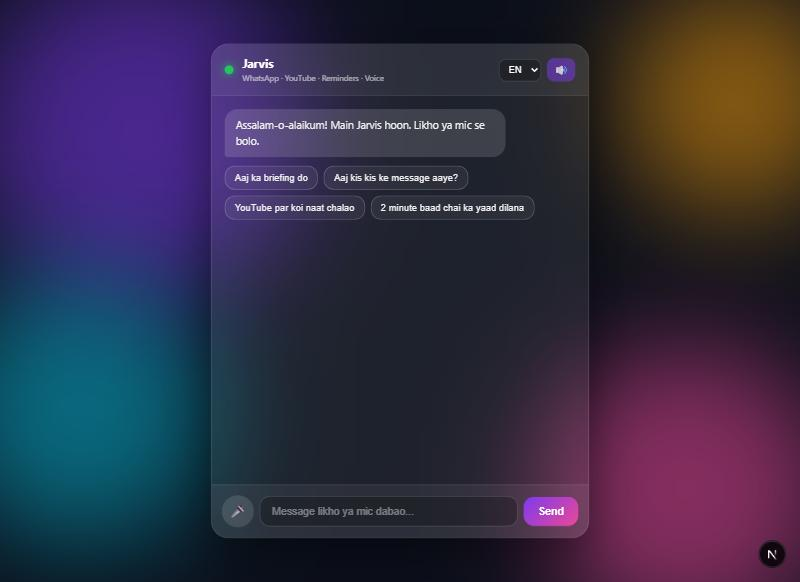
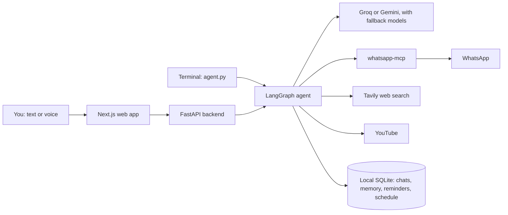

# Jarvis: WhatsApp AI Agent

A personal AI assistant that reads and sends WhatsApp messages, plays YouTube, sets reminders and talks back, in natural language and by voice.
Built with **LangGraph** (agent brain) + **whatsapp-mcp** (WhatsApp bridge) + **Groq** or **Gemini** (LLM) + **Tavily** (web search) + **FastAPI** and **Next.js** (web app).

## What you can say
| You say | Jarvis does |
|---|---|
| "Send Ali 'running late'" | Finds the contact by name, shows exactly what will be sent, and sends only after you say yes |
| "Send this tomorrow at 9" | Holds the message for your yes, then sends it at that time |
| "Who messaged me today?" | Lists chats with real names and counts, and can summarize a chat or the whole day |
| "Remind me in 2 minutes" | Shows and speaks the reminder in the app when it is due |
| "Give me today's briefing" | Today's reminders and scheduled messages, weather and a WhatsApp summary |
| "Play a song, skip 2 minutes" | Plays YouTube in the app and controls it |
| "What is this video about?" | Explains the playing video from its transcript |
| "Remember that I like strong tea" | Saves the fact across restarts, with list and forget |

## Features
- Natural language to WhatsApp actions (send messages, search chats, read history)
- Sending is held in code until you say yes, and shows exactly who and what will be sent (safety)
- Remembers conversations across restarts, and facts you explicitly ask it to remember
- 12 WhatsApp tools via Model Context Protocol (MCP)
- Web search (Tavily) for real-time info like weather, rates and news
- Voice input and spoken replies in the web app, in English and Urdu
- Voice input in the terminal: press Enter on an empty prompt, speak, press Enter again (Groq Whisper speech-to-text)
- Send by contact name: looks up names saved on your phone (from the bridge database), no phone number needed
- Real names instead of numbers in WhatsApp tool results, wherever a name is known
- WhatsApp summaries: see who messaged you and get a summary of one chat, a group or the whole day (read-only, by contact name)
- Scheduled messages in the web app: "send this tomorrow at 9", with list and cancel; saved across restarts, sent while the backend and bridge are running
- Reminders in the web app: "remind me tomorrow at 9", shown in the chat and spoken; if the app was closed, shown when it opens
- Daily briefing in the web app: today's reminders and scheduled messages, weather and a WhatsApp summary, on the day's first open or on request. Set `BRIEFING_CITY` in `.env` to include the weather
- YouTube in the web app: play any video or song, pause, resume, skip forward or back, and ask what a video contains (uses its transcript)

## Architecture

## Safety
- Messages never go out without your yes. This is enforced in code, not left to the model.
- Text inside WhatsApp messages, web pages and videos is treated as data. After reading it, the agent cannot change its memory or reminders in the same turn.
- Only the local web app can call the backend (restricted CORS).
- Chats and memory stay in local database files that git ignores. They are plain text, so keep them on a computer you trust.

## Tech Stack
- Python, LangGraph, LangChain
- langchain-mcp-adapters (MCP client)
- Groq or Google Gemini
- Tavily web search
- whatsapp-mcp (Go + Python bridge)
- FastAPI, edge-tts
- Next.js, React, YouTube IFrame API

## Setup
1. Run the whatsapp-mcp bridge (see https://github.com/lharries/whatsapp-mcp) and scan the QR code to link your WhatsApp.
2. Create and activate a virtual environment:
   - `python -m venv venv`
   - `venv\Scripts\activate`  (Windows)
3. Install dependencies: `pip install -r requirements.txt`
4. Create a `.env` file in the project root with:
   - `MODEL=groq:openai/gpt-oss-20b` and `GROQ_API_KEY=your_key_here`
     (or `MODEL=google_genai:gemini-flash-lite-latest` and `GOOGLE_API_KEY=your_key_here`)
   - `TAVILY_API_KEY=your_key_here` (for web search, get one at https://tavily.com)
   - `WHATSAPP_MCP_PATH=path/to/whatsapp-mcp/whatsapp-mcp-server`
   - `BRIEFING_CITY=Lahore` (optional, adds the weather to the briefing)
5. Install the web app: `cd frontend` and `npm install`
6. Run it:
   - Web app (all features): `start-app.bat` starts the bridge, backend and frontend. Change the `E:\` paths in it to your own folders.
   - Terminal: `python agent.py`. Type a request, or press Enter on an empty `tum>` prompt to speak it (needs a microphone and `GROQ_API_KEY`). Scheduled messages, reminders, the briefing and YouTube are only in the web app.

## How it works
You type or say a request in plain language. The LangGraph agent interprets it and calls
the right tool. Sending waits for your confirmation.
For questions that need fresh information, it searches the web first.

Conversations are saved in `chat_history.db` and facts you ask it to remember in `memories.db`, so both survive restarts. Both files stay on your computer and out of git. Stop the app and delete them to erase its memory.

To save tokens, only the last 6 turns are sent to the model. If a model fails or hits its rate limit, the agent switches to the next one in `FALLBACK_MODELS` (`models.py`).

## Note
This is a personal portfolio project for learning AI agents and tool-use.
